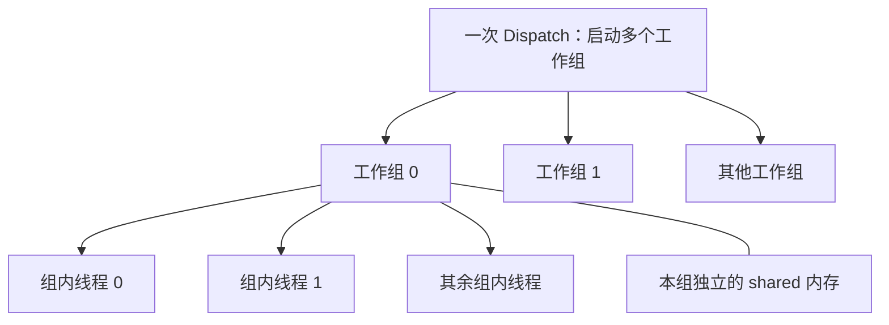

# Compute shader 计算着色器

Compute shader（计算着色器）是一种不依赖传统图形管线的GPU程序。它不会自动生成顶点或者像素，而是让大量GPU线程并行计算，并把结果写入SSBO、Image、Texture 或其他GPU资源

#### 整体流程：

```
CPU 发出一次 dispatch
        ↓
GPU 启动大量并行线程
        ↓
每个线程处理一个元素、像素或任务
        ↓
结果写入 SSBO / Image
```

#### 1.与普通图形着色器的区别：

传统渲染管线：

```
Vertex Shader
      ↓
光栅化
      ↓
Fragment Shader
      ↓
Framebuffer
```

**Compute shader不经过这些阶段**

```
Compute Shader
      ↓
SSBO / Image / Buffer / Texture
```

它没有固定的输入输出含义

- 不自动读取顶点
- 不自动生成图元
- 不自动产生Fragment
- 不自动写入Framebuffer
- 由开发者自己决定读取和写入哪些GPU资源

例如（要写入SSBO）：

```glsl
layout(std430, binding = 0) buffer Data
{
    float values[];
};
    
void main()
{
    uint index = gl_GlobalInvocationID.x;
    values[index] *= 2.0;
}
```

每个线程处理数组中的一个元素。


#### 2.Invocation: Compute Shader 的线程

Compute Shader的一次执行实例叫Invocation，可以近似理解为一个GPU线程

```
void main()
{
		//每个invocation都执行一次main里面的代码
}
```

GPU通常会同时执行大量的invocation:

```
Invocation 0 → 处理 values[0]
Invocation 1 → 处理 values[1]
Invocation 2 → 处理 values[2]
Invocation 3 → 处理 values[3]
... 
```

**它们的执行顺序通常不确定，不应该假设较小的invocation会先执行**


#### 3. Work Group: 线程组

Invocation不是孤立启动的，而是被组织成Work group

```glsl
layout(
	local_size_x = 16,
	local_size_y = 16,
	local_size_z = 1
) in;
```

表示每个工作组包含：

```
16 x 16 x 1 = 256 个 invocation
```

二维工作组：

```
Work Group
┌────────────────────────────┐
│ invocation (0,0) ... (15,0)│
│ invocation (0,1) ... (15,1)│
│ ...                        │
│ invocation (0,15)...(15,15)│
└────────────────────────────┘
```

同一个工作组内的invocation可以：

- 使用 shared 内存
- 使用 barrier() 同步
- 高效协作处理一块数据

不同工作组之间通常不能在同一次dispatch内直接同步


#### 4.Dispatch：启动计算任务

CPU通过OpenGL启动 Compute Shader:

```c++
glDispatchCompute(groupCountX, groupCountY, groupCountZ);
```

例如：

```C++
glDispatchCompute(100, 50, 1);
```

如果每一个工作组为：

```
layout(local_size_x = 16, local_size_y = 16) in;
```

那么总 invocation 的数量是：

```
X：100 × 16 = 1600
Y： 50 × 16 = 800

总数：1600 × 800
```

也就是逻辑上覆盖一张1600 x 800的图像

#### 5.常用线程编号

##### 全局线程编号

```glsl
uvec3 id = gl_GlobalInvocationID;
```

这是最常用的编号，表示当前 invocation 在整个 dispatch 中的位置

```glsl
uint index = gl_GlobalInvocationID.x;
```

二维任务：

```
ivec2 pixel = ivec2(gl_GlobalInvocationID.xy);
```

##### 工作组编号

```
uvec3 group = gl_WorkGroupID;
```

表示当前invocation属于哪个工作组

##### 组内编号

```
uvec3 local = gl_LocalInvocationID;
```

范围取决于 local_size 。例如 16x16工作组中：

```
local.x：0～15
local.y：0～15
```

##### 组内一维编号

```
uint localIndex = gl_LocalInvocationIndex;
```

把三维局部编号展开成一个连续编号：

```
0～local_size_x × local_size_y × local_size_z - 1
```

##### 编号关系

可以近似理解为：

```
GlobalInvocationID
=
WorkGroupID × WorkGroupSize
+
LocalInvocationID
```

例如：

```
工作组编号：       (2, 3)
工作组大小：       (16, 16)
局部线程编号：     (5, 7)

全局线程编号：
x = 2 × 16 + 5 = 37
y = 3 × 16 + 7 = 55
```

#### 6.为什么需要边界检查

假设处理 1000x700的图像，每组 16x16:

```glsl
GLuint groupsX = (1000 + 15) / 16; // 63
GLuint groupsY = (700  + 15) / 16; // 44

glDispatchCompute(groupsX, groupsY, 1);
```

实际启动范围：

```glsl
63 × 16 = 1008
44 × 16 = 704
```

会多出一些线程。因此Shader必须检查：

```glsl
ivec2 coord = ivec2(gl_GlobalInvocationID.xy);
ivec2 size = imageSize(outputImage);

if (any(greaterThanEqual(coord, size)))
{
    return;
}
```

否则可能产生越界访问

#### 7.完整的图像处理例子

下面的 Compute Shader 读取输入Texture，将颜色反相后写入Image

```glsl
#version 450 core

layout(local_size_x = 16, local_size_y = 16 ) in;

layout(binding = 0) uniform sampler2D inputTexture;
layout(rgba16f, binding = 1) uniform writeonly image2D outputImage;

void main()
{
	ivec2 coord = ivec2(gl_GlobalInvocationID.xy);
	ivec2 size = imageSize(outputImage);
	
	if (any(greaterThanEqual(coord, size)))
    {
        return;
    }
    
    vec4 color = texelFetch(inputTexture, coord, 0);
    color.rgb = vec3(1.0) - color.rgb;
    imageStore(outputImage, coord, color);
}
```

CPU 端：

```C++
glUseProgram(computeProgram);

// 输入纹理
glBindTextureUnit(0, inputTexture);

// 输出纹理作为 Image
glBindImageTexture(
    1,
    outputTexture,
    0,
    GL_FALSE,
    0,
    GL_WRITE_ONLY,
    GL_RGBA16F
);

GLuint groupsX = (width  + 15) / 16;
GLuint groupsY = (height + 15) / 16;

glDispatchCompute(groupsX, groupsY, 1);
```

如果下一个 Pass要采样 outputTexture：

```
glMemoryBarrier(GL_TEXTURE_FETCH_BARRIER_BIT);

glBindTextureUnit(0, outputTexture);
glDrawArrays(...);
```

完整的数据流：

```
inputTexture
      ↓ texture/texelFetch
Compute Shader
      ↓ imageStore
outputTexture
      ↓ memory barrier
下一个渲染或计算 Pass
```

#### 如何理解Compute Shader:

可以从一个普通的CPU循环理解它：

```c++
for (uint i = 0; i < count; ++i)
{
	c[i] = a[i] + b[i];
}
```

这里，每次迭代都可以独立执行。改成Compute Shader 后，你主要描述其中一个工作项：

```glsl
uint i = gl_GlobalInvocationID.x;
c[i] = a[i] + b[i];
```

然后通过一次Dispatch, 请求GPU执行多次这个程序。每次执行获得不同的i，处理不同的数据。

这里的单次执行叫做Invocation，通常也称为“线程”。它是GPU的逻辑执行实例，并不是操作系统线程，也不意味着每个实例都独占一个物理核心。GPU会分批调度它们。

#### 与其它Shader的区别：

| Shader 类型     | 执行由什么触发     | 单次执行主要处理什么             | 典型输出             |
| --------------- | ------------------ | -------------------------------- | -------------------- |
| Vertex Shader   | 绘制命令及顶点输入 | 一个顶点及其属性                 | 顶点位置、插值属性   |
| Fragment Shader | 光栅化产生的片元   | 一个片元，具体还受采样等机制影响 | 颜色、深度等         |
| Compute Shader  | 显式 Dispatch      | 程序自行定义的工作项             | 缓冲区、纹理中的数据 |

Compute Shader 的调度不依赖三角形的覆盖，没有自动的深度测试和混合操作。需要自行计算访问坐标，并显式写入输出资源。

##### 它给使用者更多控制权，同时也要求使用者自行处理边界、数据冲突和同步

Compute Shader的工作项并非完全平铺，它们按照Dispatch → Workgroup → Invocation组织



Workgroup（工作组，也叫线程组）是协作的基本单位：同组线程可以共享内存，并在组内设置同步点。

在GLSL中，可以这样声明每个组包含多少线程：

```glsl
layout(local_size_x = 256,
       local_size_y = 1,
       local_size_z = 1) in;
```

这里每组有：

```
256 × 1 × 1 = 256 个线程
```

CPU侧再指定启动多少个组：

```c++
glDispatchCompute(4, 1, 1);
```

因此总共启动：

```
4 × 256 = 1024 个线程
```

Dispatch的参数是工作组的数量，不是线程总数。

#### 每个线程可以读取的几个内置编号：

| 含义                             | GLSL                      | HLSL                  |
| -------------------------------- | ------------------------- | --------------------- |
| 当前工作组的坐标                 | `gl_WorkGroupID`          | `SV_GroupID`          |
| 当前线程在组内的坐标             | `gl_LocalInvocationID`    | `SV_GroupThreadID`    |
| 当前线程在整个 Dispatch 中的坐标 | `gl_GlobalInvocationID`   | `SV_DispatchThreadID` |
| 组内坐标展平后的一维编号         | `gl_LocalInvocationIndex` | `SV_GroupIndex`       |

其中最重要的关系是：

```
全局线程坐标 = 工作组坐标 × 工作组尺寸 + 组内线程坐标
```

乘法和加法都是逐分量计算。例如一维情况下：

```
每组 256 个线程
当前组编号 = 3
组内线程编号 = 7

全局线程编号 = 3 × 256 + 7 = 775
```

这也是为什么同一份Shader代码可以处理不同的数据

二维、三维只是更方便的数据索引方式。例如：

```
layout(local_size_x = 16, local_size_y = 16) in;
```

可以让每个组负责图像上的一个`16x16`区域：

```
ivec2 pixel = ivec2(gl_GlobalInvocationID.xy);
```

对于 `1920 × 1080` 图像，需要：

```
X 方向：ceil(1920 / 16) = 120 组
Y 方向：ceil(1080 / 16) = 68 组
```

即：

```
glDispatchCompute(120, 68, 1);
```

实际覆盖高度是`68 x 16 = 1088`，因此最后几行线程超出图像范围，需要做边界检查。

注意，“一个线程处理一个像素”只是使用者选择的映射方式。一个线程也可以处理多个像素、一个粒子、一条光线，或者数组中的多个元素。

把这些概念放在一起，可以得到一个数组相加的完整Shader:

```glsl
	#version 430 core
    
    //每个工作组有256个线程。
    layout(local_size_x = 256) in;
	
	//三个缓冲区，由CPU绑定到对应binding
	layout(std430, binding = 0) readonly buffer InputA{
    	float a[];
	};
        
    layout(std430, binding = 1) readonly buffer InputB {
        float b[];
    };
    
    layout(std430, binding = 2) writeonly buffer OutputC {
    	float c[];
	};
        
    uniform uint count;

	void main()
    {
        uint i = gl_GlobalInvocationID.x;
        
        //启动的线程数可能大于实际元素的数量
        if(i >= count){
            return;
        }
        
        c[i] = a[i] + b[i];
    }
```


CPU侧的代码如下，这里假设程序已经编译链接，缓冲区已经分配并填好数据：

```c++
    glUseProgram(program);

    glBindBufferBase(GL_SHADER_STORAGE_BUFFER, 0, bufferA);
    glBindBufferBase(GL_SHADER_STORAGE_BUFFER, 1, bufferB);
    glBindBufferBase(GL_SHADER_STORAGE_BUFFER, 2, bufferC);

    glUniform1ui(glGetUniformLocation(program, "count"), count);

    GLuint groupCount = (count + 255u) / 256u;
    glDispatchCompute(groupCount, 1, 1);

    // 假设后续 GPU 操作通过 SSBO 读取结果。
    glMemoryBarrier(GL_SHADER_STORAGE_BARRIER_BIT);
```

注意：因为每个线程只写自己的`c[i]`，线程之间没有数据依赖，因此这个例子不需要同步。


##### 接下来需要理解：线程自己的变量、组内共享内存、全局资源，是三种不同层次的数据。

| 数据类别       | GLSL中的典型形式            | 访问范围               | 常见用途                 |
| -------------- | --------------------------- | ---------------------- | ------------------------ |
| 私有变量       | 函数中的变量                | 当前线程               | 索引、中间计算结果       |
| 组内共享内存   | shared                      | 当前工作组             | 局部统计、分块缓存、归约 |
| 全局存储缓冲区 | SSBO：`buffer`              | 绑定该资源的着色器调用 | 大数组、粒子、几何数据   |
| 纹理与图像     | `sampler2D`、`image2D`      | 绑定该资源的着色器调用 | 图像读取、采样、写入     |
| 同一参数       | `uniform` 、`uniform block` | 一次执行任务的公共输入 | 数量、矩阵、算法参数     |

私有变量通常会使用寄存器，但这由编译器决定；寄存器不足时可能发生溢出，带来额外访存。

`shared`通常对应片上共享存储，适合让同组线程重复利用这一批数据。例如：

```glsl
shared float tile[256];
```

每个工作组都有自己独立的`tile`。组0的`tile[0]`和组1的`tile[0]`不是同一个地址。

它也不会自动清零，必须由程序初始化。

全局缓冲区或图像则可以跨组访问，**但能够访问同一块数据，并不代表访问顺序或者结果可见性已经得到保证**。

一个常见的shared优化是图像模糊：相邻输出像素会读取大量重叠的输入像素，可以先让一个工作组协作加载一个图像块，再反复读取shared中的数据。不过，加载、同步和共享内存占用也有成本，需要测量是否划算

PS：如SVGF的第一轮滤波可以尝试用shared memory进行优化


#### 同步是 Compute Shader最需要认真处理的部分。 可以把它拆成三个问题：

- 其他线程是否已经执行到某个位置？
- 它们写入的数据是否能被正确看见
- 多个线程同时修改同一位置，是否会发生冲突？

这三个问题分别涉及执行同步、内存同步和原子操作。

可以参考RR里面的一段源码：

```glsl
#include "common.glsl"

#define GROUP_SIZE 256
#define SS_RRRT_RADIX_SORT_BITS 255
#define SS_RRRT_RADIX_SORT_BINS (SS_RRRT_RADIX_SORT_BITS + 1)

layout (local_size_x = GROUP_SIZE, local_size_y = 1, local_size_z = 1) in;

layout(std430, binding = ss_storage_binding_SORT_KEY_BUFFER) readonly buffer Sort_Key_Buffer
{
    uint sort_key_buffer[];
};
layout(std430, binding = ss_storage_binding_SORT_INDEX_BUFFER) readonly buffer Sort_Index_Buffer
{
    uint sort_index_buffer[];
};
layout(std430, binding = ss_storage_binding_HISTOGRAM_BUFFER) writeonly buffer Histogram_Buffer
{
    uint histogram_buffer[];
};

uniform int num_elements;
uniform int sort_shift;
uniform int num_blocks_per_group;

shared uint s_histogram[SS_RRRT_RADIX_SORT_BINS];

void main()
{
    const int local_id = int(gl_LocalInvocationID.x);
    const int group_id = int(gl_WorkGroupID.x);

    if (local_id < SS_RRRT_RADIX_SORT_BINS) {
        s_histogram[local_id] = 0;
    }
    barrier();

    for (int i = 0; i < num_blocks_per_group; i++) {
        int element_id = (group_id * num_blocks_per_group + i) * GROUP_SIZE + local_id;
        if (element_id < num_elements) {
            uint index = sort_index_buffer[element_id];
            uint value = sort_key_buffer[index];
            uint bits = (value >> sort_shift) & SS_RRRT_RADIX_SORT_BITS;
            atomicAdd(s_histogram[bits], 1);
        }
    }
    barrier();

    if (local_id < SS_RRRT_RADIX_SORT_BINS) {
        histogram_buffer[group_id * SS_RRRT_RADIX_SORT_BINS + local_id] = s_histogram[local_id];
    }
}
```

当前配置有256个桶，每组也有256个线程。主要流程是：

```
各线程把自己负责的桶清零
            ↓
        barrier()
            ↓
各线程读取数据，用 atomicAdd 更新对应桶
            ↓
        barrier()
            ↓
各线程将桶的结果写入全局缓冲区
```

第一个`barrier()`保证所有线程完成初始化，再开始统计。

否则可能发生：

